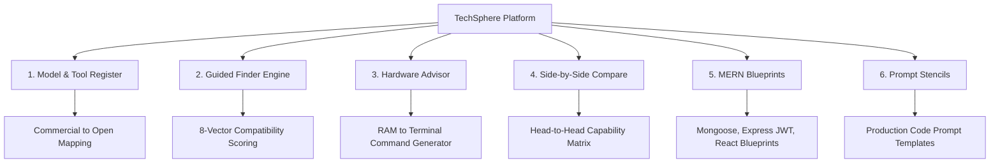

# Product Requirements Document (PRD)
## Project: TechSphere
**Document Version:** 1.0.0  
**Status:** Approved & Implemented  
**Date:** November 2026  
**Author:** Senior Full-Stack Engineering & Product Architecture Team  
**Repository:** `techsphere/` (MERN Architecture)

---

## 1. Executive Summary

**TechSphere** is a high-precision, developer-focused search engine and architecture registry for machine intelligence and open compute. It answers one central question:

> *"Which AI model or tool should I use for this exact task, and what is the best free / open-source alternative I can run myself?"*

TechSphere unifies frontier commercial AI capabilities (e.g. Claude 3.7 Sonnet, OpenAI o3/GPT-4.5) with local, self-hosted alternatives (e.g. DeepSeek-V3, Qwen 2.5, Phi-4, Ollama, Aider) in a clean, high-performance interface with zero decorative noise or marketing hyperbole.

---

## 2. Problem Statement & Market Analysis

### 2.1 The Problem
1. **Model Proliferation & Analysis Paralysis**: Over 200+ commercial AI tools, APIs, and open-weight models exist without a task-oriented index. Developers waste hours testing models for specific engineering tasks.
2. **SaaS Cost Escalation & Vendor Lock-In**: Developer teams accumulate compounding monthly subscriptions ($20–$50/seat/month) for tools that can be replaced by open-weight models running on local hardware.
3. **Data Sovereignty & Privacy Concerns**: Proprietary codebases and sensitive enterprise schemas cannot legally or securely be sent to external cloud APIs under strict corporate compliance.
4. **Hardware-to-Execution Friction**: Open models are powerful, but developers lack clear guidance on whether their local RAM/VRAM (8GB, 16GB, 32GB, 64GB) can run a specific quantization and need exact terminal commands to get started without trial and error.

### 2.2 TechSphere's Solution
- **Task-Based Indexing**: Direct mapping from developer tasks to optimal models.
- **Commercial ➔ Open Alternative Register**: Every proprietary tool is paired with its verified free, open-source, or local counterpart.
- **Hardware-Aware Command Generation**: Zero-guess terminal commands (`ollama run ...`) tailored to system RAM.
- **Guided Recommendation Algorithm**: Multi-factor questionnaire scoring tools across 8 capability vectors.
- **Zero API Key Dependency**: Runs completely self-contained with an internal rule-based synthesis engine and in-memory database fallback.

---

## 3. User Personas

| Persona | Role | Primary Objective | Key Pain Point | TechSphere Feature Used |
|---|---|---|---|---|
| **Alex** | Full-Stack Software Engineer | Find the best coding assistant for MERN API refactoring | Unsure whether to pay for Cursor or use local tools | AI Model Register & Commercial ➔ Open Mappings |
| **Priya** | Engineering Lead / CTO | Enforce privacy compliance and cut API costs | Corporate code cannot leave local networks | Hardware Advisor (Ollama CLI commands) & Blueprints |
| **Marcus** | AI Tinkerer / Student | Run models locally on a 16GB MacBook | Quantization confusion and broken setup scripts | Guided Finder & Terminal Advisor |

---

## 4. The Six Functional Pillars



### 4.1 Pillar 1: AI Model & Open-Source Register
- **Description**: An indexed directory of AI models and tools.
- **Signature Feature**: Each entry highlights a **Commercial ➔ Open Alternative** relationship.
  - *Example*: Full-Stack MERN Routing: `Claude 3.7 Sonnet` ➔ `DeepSeek-V3 (Open Alternative)`
  - *Example*: In-Editor Completion: `GitHub Copilot` ➔ `Continue.dev + Ollama Qwen 2.5`
  - *Example*: Autonomous Coding: `Cursor` ➔ `Aider + DeepSeek-V3 / Cline`
- **Filtering System**:
  - Filter by Task Category (Full-Stack Coding, STEM Reasoning, Agentic, Terminal/DevOps, UI/Design).
  - Filter by License (Commercial, Open Source, Free Tier).
  - Filter by Execution Target (Cloud API vs. Local Offline).
- **Search Capabilities**: Instant search with text index matching on name, vendor, task description, and alternative tags.

### 4.2 Pillar 2: Guided Finder & Recommendation Algorithm
- **Description**: A 60-second questionnaire evaluating user needs across six dimensions:
  1. Primary Task Category
  2. Budget & Licensing Tolerance
  3. Reasoning Depth (Scale 1–10)
  4. Speed Sensitivity (Real-time sub-second vs. deep reasoning)
  5. UI / Visual Comprehension Level
  6. Execution Environment (Local offline vs. cloud hosted)
- **Scoring Engine**:
  $$\text{Match Score} = w_{\text{category}} \cdot S_{\text{cat}} + w_{\text{budget}} \cdot S_{\text{bud}} + w_{\text{reasoning}} \cdot S_{\text{res}} + w_{\text{speed}} \cdot S_{\text{spd}} + w_{\text{exec}} \cdot S_{\text{loc}}$$
- **Contextual Synthesis**: Produces a customized "Why this fits you" explanation. Uses deterministic rule-based template generation by default; enriches via Google Gemini API if `GEMINI_API_KEY` is provided.

### 4.3 Pillar 3: Quick Stack Terminal & Hardware Advisor
- **Description**: Direct hardware-to-command profiler.
- **Supported RAM Profiles**:
  - **8 GB RAM**: Recommends `Mistral 7B` or `Qwen 2.5 7B` (`ollama run mistral:7b`)
  - **16 GB RAM**: Recommends `Phi-4 (14B)` or `Qwen 2.5 Coder 14B` (`ollama run phi4`)
  - **32 GB RAM**: Recommends `DeepSeek-V3 (Q4_K_M)` (`ollama run deepseek-v3`)
  - **64 GB+ RAM**: Recommends `DeepSeek-R1 (70B)` or `Llama 3.3 70B` (`ollama run deepseek-r1:70b`)
- **Features**: Single-click clipboard copying with visual feedback and hardware requirement notes.

### 4.4 Pillar 4: Side-by-Side Comparison Matrix
- **Description**: Enables developers to check up to 3 models simultaneously across a uniform parameter matrix:
  - Pricing Model & Starting Price per Month
  - Open Source & Local Offline Execution capability
  - IDE Integration & Agentic Capabilities
  - Context Window capacity (in tokens)
  - Radar breakdown across Reasoning, Coding, Speed, and UI Sense

### 4.5 Pillar 5: MERN Architecture Blueprints
- **Description**: Production reference implementations for modern full-stack web applications:
  - **Database**: Mongoose schemas with compound indexes, soft deletes, and validation.
  - **Backend**: Express router patterns, JWT authentication inside secure `httpOnly` cookies, rate limiting, and centralized error handling.
  - **Frontend**: React 18, Vite, TanStack Query caching, and Tailwind CSS design tokens.

### 4.6 Pillar 6: Prompt Stencils Catalog
- **Description**: Production-grade prompt stencils tailored to frontier reasoning models:
  - API Endpoint Architecture Stencil
  - Complex SQL / Mongoose Migration Review Stencil
  - TypeScript Strict Refactoring Stencil
  - Comprehensive Unit Test Generator Stencil

---

## 5. Technical Architecture

### 5.1 Technology Stack

```
TechSphere/
├── client/                     # Frontend Application
│   ├── src/
│   │   ├── components/         # Reusable UI components & layouts
│   │   ├── pages/              # Route pages (Home, Search, Find, Compare, Blueprints)
│   │   ├── lib/api.js          # Centralized Axios client with interceptors
│   │   ├── store/authStore.js  # Client-side user auth state
│   │   └── index.css           # Design tokens & typography rules
│   ├── index.html              # HTML shell with Google Fonts preconnect
│   ├── tailwind.config.js      # Custom Design Tokens v2 palette
│   └── vite.config.js          # Vite build config with backend proxy
│
└── server/                     # Backend API & Database
    ├── src/
    │   ├── controllers/        # Request orchestration (search, recommend, compare)
    │   ├── models/             # Mongoose schemas (Tool, Registry, Review, User)
    │   ├── routes/             # Express API route modules (/api/v1/...)
    │   ├── middleware/         # Auth, validation, rate limiting, error handler
    │   └── utils/              # Recommendation algorithm & Gemini fallback
    └── seed/                   # 2026 data seeding scripts
```

### 5.2 Frontend Design System (v2 Specifications)
- **Typography**:
  - UI Text: `Plus Jakarta Sans` (400/500/600), strictly `letter-spacing: 0`.
  - Code, Commands & Tags: `Roboto Mono` (400/500).
  - Headings: `letter-spacing: -0.025em` with `text-wrap: balance`.
- **Color Palette Tokens**:
  - `canvas`: `#FFFFFF`
  - `surface`: `#F8F9FA`
  - `surfaceHover`: `#F1F3F4`
  - `border`: `#E0E0E0`
  - `ink`: `#202124` (High AA contrast text)
  - `muted`: `#5F6368`
  - `subtle`: `#80868B`
  - `blue`: `#1A73E8`
  - `blueHover`: `#1765CC`
  - `blueBg`: `#E8F0FE`
  - `success`: `#1E8E3E` (bg `#E6F4EA`)
  - `warning`: `#B06000` (bg `#FEF7E0`)
  - `danger`: `#D93025` (bg `#FCE8E6`)
- **Container Standard**: Standardized on unified `max-w-4xl` across Home, Search, Compare, Blueprints, and Profile.
- **Card Architecture**: Flattened single-border containers with internal dividers (`divide-y divide-border`) to eliminate nested-card visual noise.

### 5.3 Backend Architecture & Security
- **Authentication**: JWT stored in `httpOnly`, `SameSite=Lax`, `Secure` cookies to eliminate XSS token theft.
- **Security Headers**: `helmet` enabled with strict content security and referrer policy.
- **CORS Configuration**: Configured with credentials enabled for explicit origin whitelisting.
- **Rate Limiting**: `express-rate-limit` guarding API routes against automated scraping.
- **Dual Database Mode**:
  - Production: Connects via `MONGO_URI` to MongoDB Atlas.
  - Development / Demo: Automatic fallback to `mongodb-memory-server` with self-populating seed data if no external database is provided.

---

## 6. Data Integrity & Verification Standards

1. **Elimination of Synthetic Metrics**: All fake placeholder star ratings (e.g. `★ 4.8, 250 reviews`) have been removed. Tools with zero community reviews display as `"Unrated (0 community reviews)"`.
2. **Authentic Community Reviews**: Reviews require authenticated user submission and backend approval before publication.
3. **Verified 2026 Model Catalog**: All model names, vendors, and parameter counts reflect 2026 realities (Claude 3.7 Sonnet, DeepSeek-V3, DeepSeek-R1, GPT-4.5, Llama 3.3 70B, Qwen 2.5 Coder, Phi-4).
4. **Vetted Pairings**: Erroneous mappings (such as pairing Bolt.new as a Cursor equivalent) were replaced with authentic developer workflows (Cursor ➔ Aider / Cline / Continue.dev).

---

## 7. API Endpoints Specification

| Method | Endpoint | Description | Auth Required |
|---|---|---|---|
| `GET` | `/api/v1/health` | Service and database connection health check | No |
| `GET` | `/api/v1/tools` | Query tool directory with category, license, and pagination | No |
| `GET` | `/api/v1/tools/:slug` | Deep-dive tool specifications, benchmark radar, alternatives | No |
| `GET` | `/api/v1/registry` | Fetch commercial-to-open alternative mapping pairs | No |
| `POST` | `/api/v1/recommend` | Submit guided finder answers; returns scored recommendations | No |
| `GET` | `/api/v1/compare` | Fetch side-by-side comparison matrix for up to 3 slugs | No |
| `GET` | `/api/v1/search/trending`| Retrieve top trending search queries | No |
| `POST` | `/api/v1/reviews` | Submit user review and rating for a tool | Yes (JWT) |
| `POST` | `/api/v1/auth/login` | Authenticate user and issue httpOnly JWT | No |
| `GET` | `/api/v1/auth/me` | Fetch authenticated user profile & saved tools | Yes (JWT) |

---

## 8. Non-Functional Requirements

- **Performance**:
  - Client Initial Load: < 1.0s on standard broadband.
  - Search / Filter Latency: < 80ms query execution via compound indexes.
- **Accessibility (a11y)**:
  - All interactive elements meet WCAG 2.1 AA color contrast ratio (minimum 4.5:1 for body copy).
  - Screen-reader accessible toggle buttons (`role="checkbox"`, `aria-checked`).
  - Visible keyboard focus rings on all interactive components.
- **Cross-Device Responsiveness**:
  - Fully verified layouts across Mobile (375px), Tablet (768px), and Desktop (1440px).

---

## 9. Deliverables & Documentation

- **Production Presentation Deck**: [`TechSphere_Presentation.pptx`](file:///C:/Users/mohdk/.gemini/antigravity/scratch/techsphere/TechSphere_Presentation.pptx) (12 widescreen 16:9 slides).
- **Interactive Web Presentation Deck**: [`TechSphere_Slides.html`](file:///C:/Users/mohdk/.gemini/antigravity/scratch/techsphere/TechSphere_Slides.html).
- **Full Project Source Code**: [`techsphere/`](file:///C:/Users/mohdk/.gemini/antigravity/scratch/techsphere)
- **Live Local Servers**: [http://localhost:5173](http://localhost:5173) (Frontend) / [http://localhost:5001](http://localhost:5001) (API).
