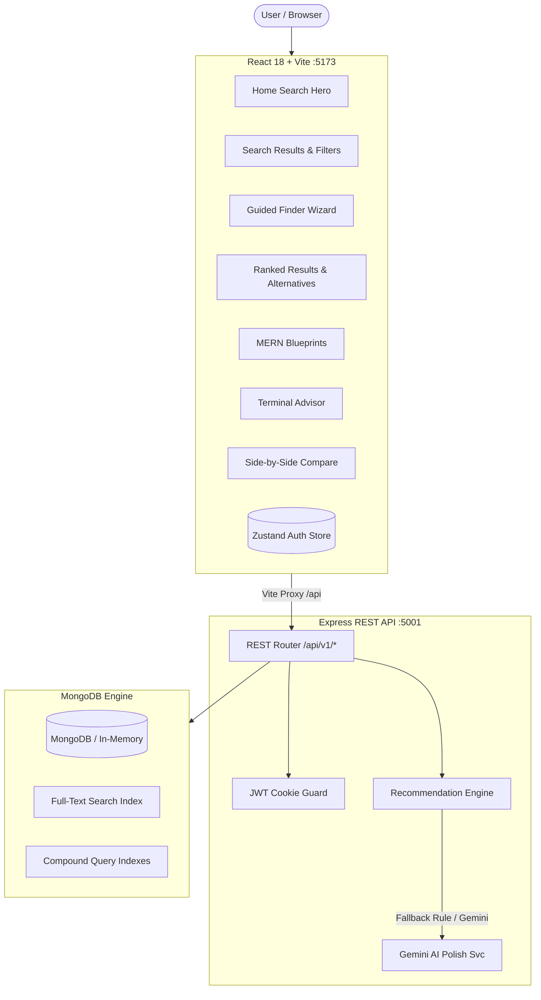

# TechSphere — AI Model, Open-Source Register & MERN Architecture Guide

A Google-style search engine and decision architecture platform that answers:
> *"Which AI model or tool should I use for this exact task?"*

Built strictly in the clean, ultra-minimal Google design aesthetic defined in `design/reference.html`.

---

## 🏗 System Architecture



---

## ⚡ Key Features

1. **AI Model & Open-Source Register**: Exact mapping of tasks to commercial models and their free / open-source / local alternatives (e.g. Claude 3.5 Sonnet → DeepSeek-V3).
2. **Google-Style Full-Text Search**: Live debounced search with match highlighting, category chips, and filter toggles.
3. **60-Second Guided Finder**: 6-step progressive questionnaire calculating personalized 0-100 compatibility scores with "Why this fits you" rationales.
4. **MERN Architecture Guide**: Blueprints for MongoDB strict schemas, Express JWT error middleware, and Vite/TanStack query caching with copyable code snippets.
5. **Quick Stack Terminal Advisor**: Hardware-aware terminal command generator (OS, RAM, VRAM) matched with compatible local Ollama models.
6. **Anti-Gravity Stencil Library**: Real copyable prompt templates with 2-second visual clipboard feedback.
7. **Side-by-Side Comparison**: Multi-attribute comparison table for up to 3 selected tools.
8. **Auth, Dashboard & Admin**: Cookie-based JWT auth, user bookmarks, community reviews, and admin dashboard with system analytics.

---

## 🚀 Quick Start (Zero Config)

The project includes an embedded in-memory MongoDB fallback. It requires **no local MongoDB server** and **no API keys** to run.

```bash
# 1. Install all dependencies across root, server, and client
npm run install:all

# 2. Seed database (25+ tools, 18+ registry rows, blueprints, templates)
npm run seed

# 3. Start development servers (Express on :5001 + Vite on :5173)
npm run dev
```

Open your browser at:
👉 **http://localhost:5173**

---

## 🧪 Testing

Run recommendation engine unit tests:
```bash
npm test
```

---

## 🗺 Roadmap (Out of Scope for v1)

- [ ] Automated live benchmark scraping & pricing sync
- [ ] Email verification & password reset workflows
- [ ] Dark mode toggle (design tokens are already prepared in `tailwind.config.js`)
- [ ] Third-party OAuth (Google, GitHub)
- [ ] Stripe / LemonSqueezy subscription integration
